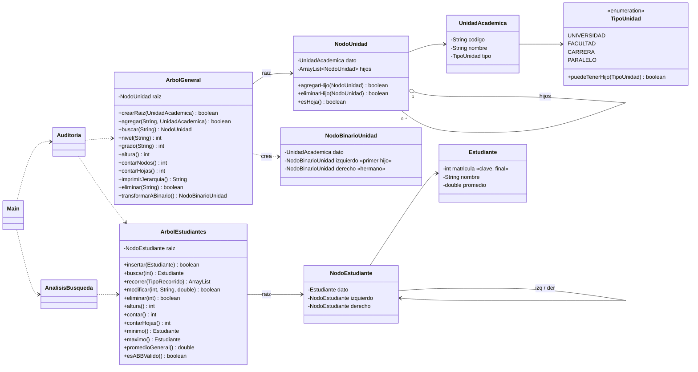
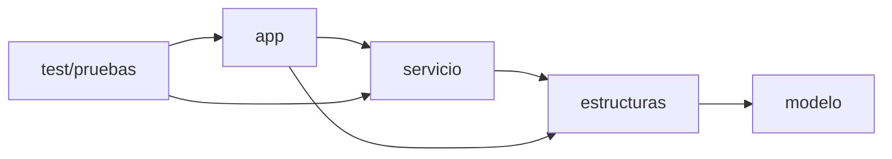
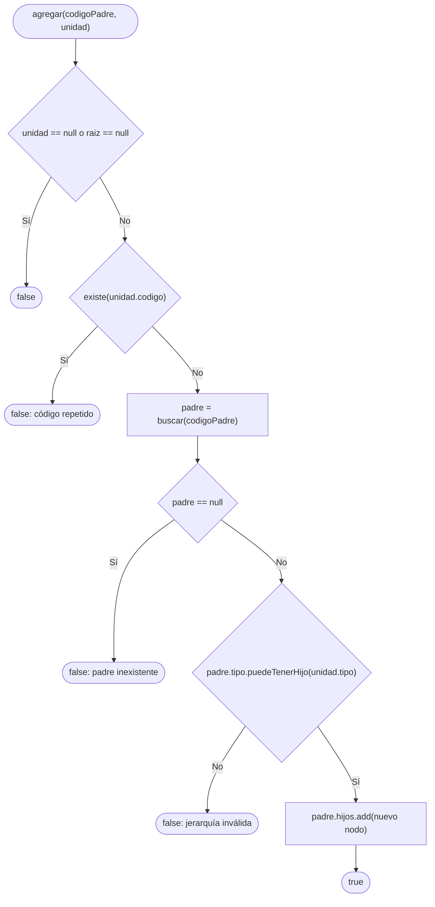
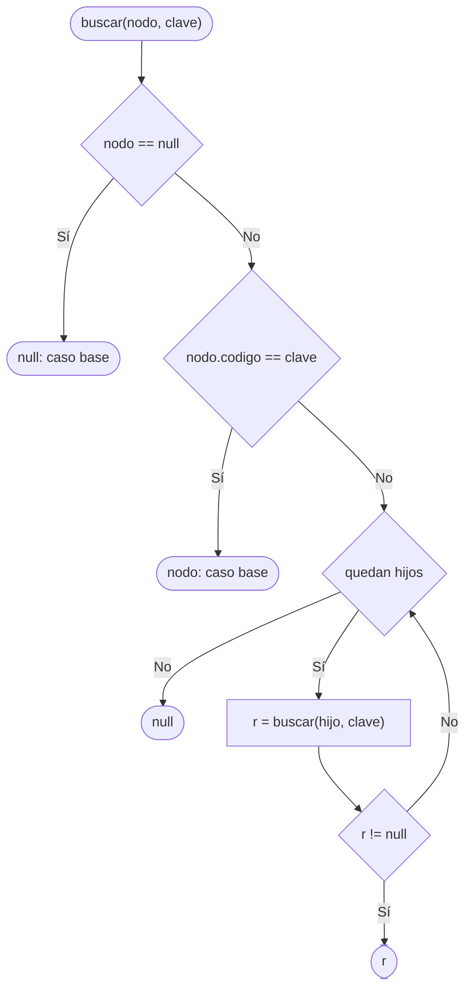

# Diagrama de clases y base del árbol general

> **Responsable:** Damian Cunalata · **Rama:** `feature/damian-base-arbol-general`
>
> **Para qué:** mostrar las capas del proyecto, cómo se unen los dos árboles y cómo `agregar` valida código único, padre existente y relación padre–hijo.

## Diagrama de clases

## Paquetes

## Flujo de agregar(codigoPadre, unidad)

## Flujo de buscar(nodo, clave) — recursivo, O(N)

