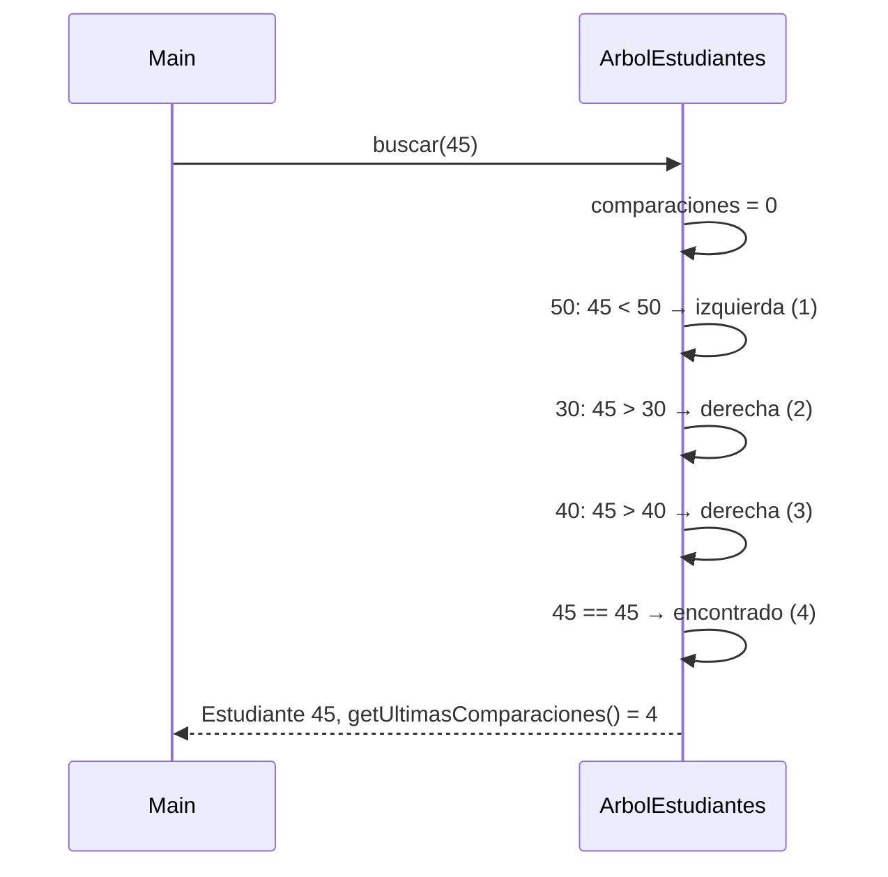
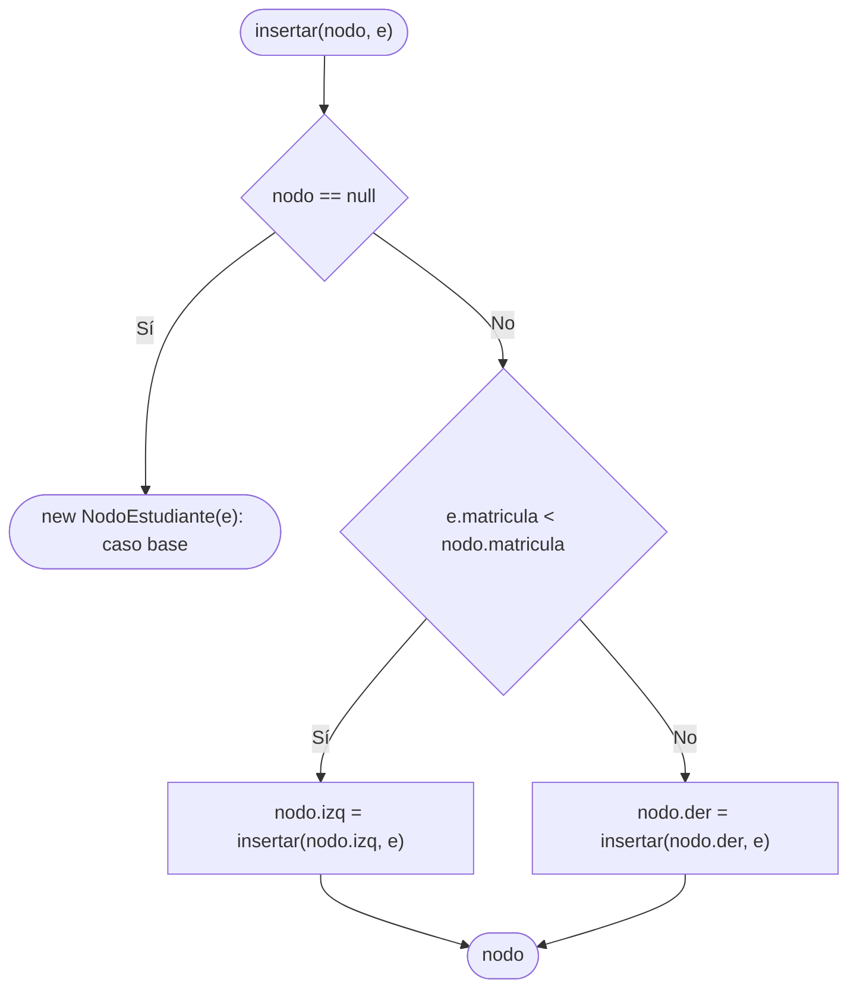

# ABB: insertar, buscar y recorridos

> **Responsable:** Mateo Chalco · **Rama:** `Mateo-Chalco`
>
> **Para qué:** inserción recursiva sin duplicados, búsqueda O(h) con contador de comparaciones y los tres recorridos.

## ABB tras las 12 inserciones (50, 30, 70, 20, 40, 60, 80, 35, 45, 65, 75, 85)

```mermaid
flowchart TD
    50 --> 30
    50 --> 70
# ABB: insertar, buscar y recorridos

> **Responsable:** Mateo Chalco · **Rama:** `Mateo-Chalco`
>
> **Para qué:** inserción recursiva sin duplicados, búsqueda O(h) con contador de comparaciones y los tres recorridos.

## ABB tras las 12 inserciones (50, 30, 70, 20, 40, 60, 80, 35, 45, 65, 75, 85)

```mermaid
flowchart TD
    50 --> 30
    50 --> 70
    30 --> 20
    30 --> 40
    40 --> 35
    40 --> 45
    70 --> 60
    70 --> 80
    60 --> 65
    80 --> 75
    80 --> 85
```

## Flujo de insertar(nodo, e)


El duplicado se detecta antes con `buscarNodo`: si existe, `insertar` devuelve `false` y el árbol no cambia.

## Secuencia de buscar(45)



## Recorridos

| Recorrido | Orden | Resultado |
|---|---|---|
| Preorden | visita, izq, der | 50 30 20 40 35 45 70 60 65 80 75 85 |
| Inorden | izq, visita, der | 20 30 35 40 45 50 60 65 70 75 80 85 |
| Posorden | izq, der, visita | 20 35 45 40 30 65 60 75 85 80 70 50 |

    30 --> 20
    30 --> 40
    40 --> 35
    40 --> 45
    70 --> 60
    70 --> 80
    60 --> 65
    80 --> 75
    80 --> 85
```

## Flujo de insertar(nodo, e)



El duplicado se detecta antes con `buscarNodo`: si existe, `insertar` devuelve `false` y el árbol no cambia.

## Secuencia de buscar(45)


## Recorridos

| Recorrido | Orden | Resultado |
|---|---|---|
| Preorden | visita, izq, der | 50 30 20 40 35 45 70 60 65 80 75 85 |
| Inorden | izq, visita, der | 20 30 35 40 45 50 60 65 70 75 80 85 |
| Posorden | izq, der, visita | 20 35 45 40 30 65 60 75 85 80 70 50 |
