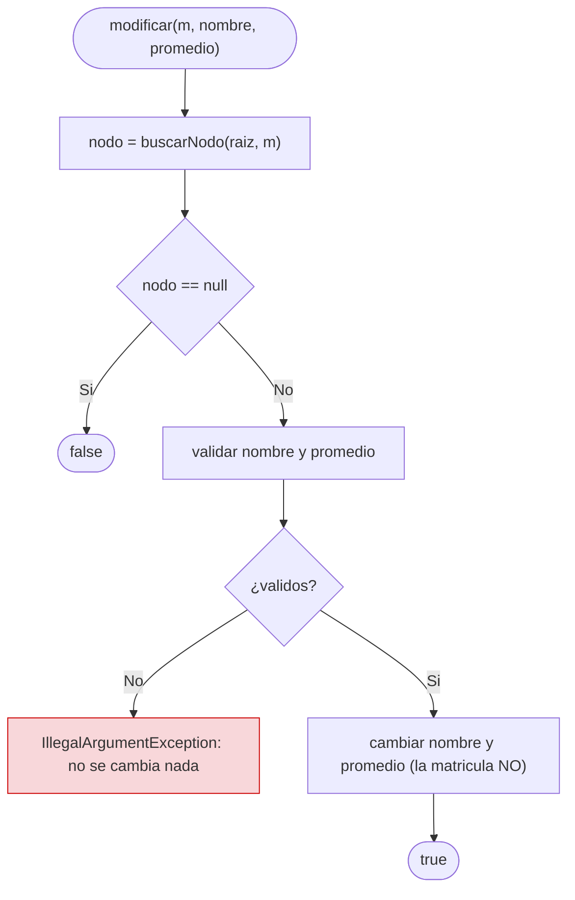
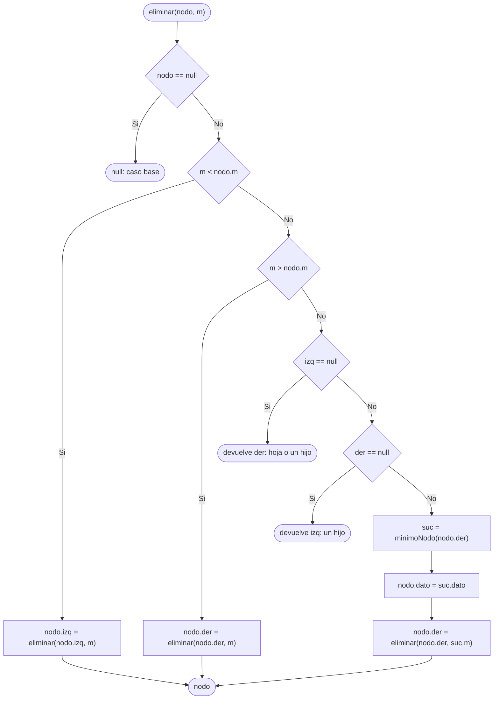
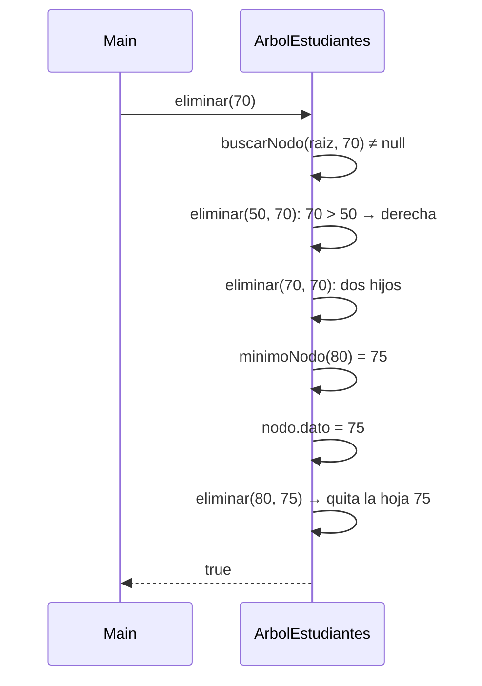

# ABB: modificar y eliminar

> **Responsable:** Luis Silva · **Rama:** `feature/luis-abb-modificar-eliminar`
>
> **Para que:** modificar sin tocar la clave y eliminar en los tres casos (hoja, un hijo, dos hijos).

## Flujo de modificar(matricula, nombre, promedio)

Cambiar la matricula sin reposicionar el nodo romperia el orden: si 35 pasara a 99, quedaria a la izquierda de 50 siendo mayor. Por eso la matricula es `final`; para cambiarla se elimina y se vuelve a insertar.

## Flujo de eliminar(nodo, m)

## Traza del enunciado

| Paso | Caso | Que pasa | Inorden |
|---|---|---|---|
| eliminar(20) | hoja | 30 pierde su hijo izquierdo | 30 35 40 45 50 60 65 70 75 80 85 |
| eliminar(60) | un hijo | 65 sube al lugar de 60 | 30 35 40 45 50 65 70 75 80 85 |
| eliminar(70) | dos hijos | sucesor inorden = 75 (menor del subarbol derecho) | 30 35 40 45 50 65 75 80 85 |

El sucesor inorden es mayor que todo el subarbol izquierdo (65) y menor que el resto del derecho (80, 85), por eso el ABB sigue ordenado.

## Secuencia de eliminar(70)

