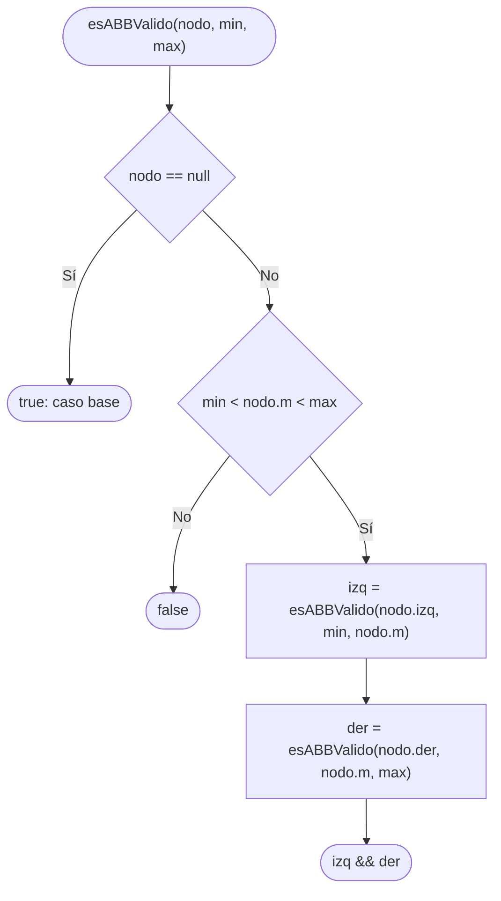
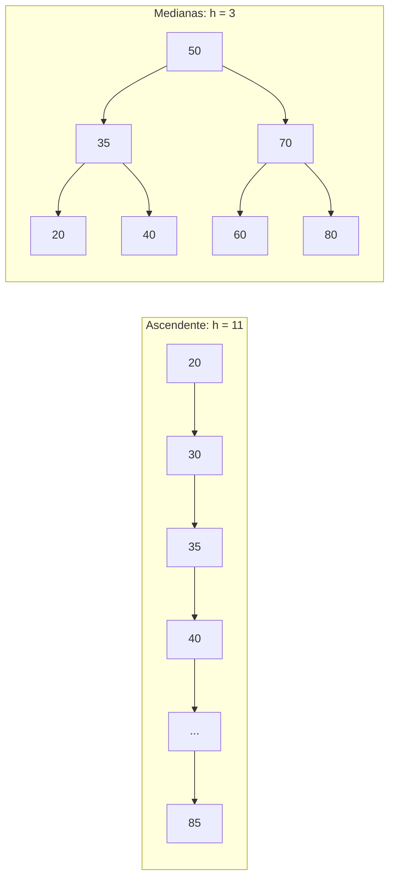

# ABB: métricas y análisis de búsqueda

> **Responsable:** Sara Tacuri · **Rama:** `feature/sara-abb-metricas-analisis`
>
> **Para qué:** altura, hojas, mínimo, máximo, promedio, invariante del ABB y la comparación cadena vs equilibrado.

## Flujo de esABBValido(nodo, min, max)

Comparar solo con el padre no basta: hay que heredar los límites de todos los ancestros.

## Métricas con los datos del enunciado

| Métrica | Valor | Complejidad |
|---|---|---|
| altura() | 3 (vacío = -1, un nodo = 0) | O(n) |
| contar() | 12 | O(n) |
| contarHojas() | 6 (20, 35, 45, 65, 75, 85) | O(n) |
| minimo() / maximo() | 20 / 85 | O(h) |
| promedioGeneral() | 97.0 / 12 = 8.08 | O(n) |

## Análisis: mismo tamaño, distinta forma

| ABB (n = 12) | Altura | Buscar 85 (existe) | Buscar 90 (no existe) |
|---|---|---|---|
| Cadena (ascendente) | 11 | 12 comparaciones | 12 comparaciones |
| Equilibrado (medianas) | 3 | 4 comparaciones | 4 comparaciones |

La búsqueda cuesta O(h). En la cadena h = n − 1, así que es O(n); en el construido por medianas h ≈ log₂ n, así que es O(log n). **No es un árbol autoequilibrado**: el equilibrio depende solo del orden de inserción y se pierde si luego se insertan datos ordenados.
