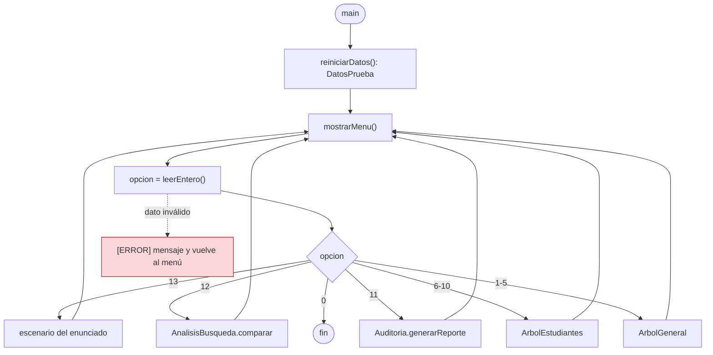
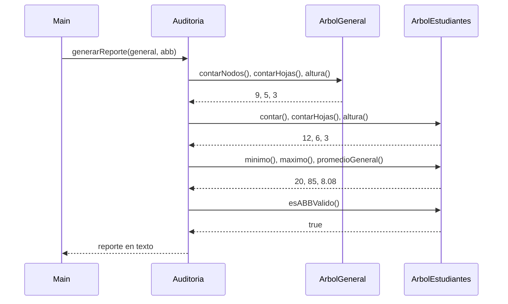

# Integración: menú y auditoría

> **Responsable:** Josue Camacho · **Rama:** `feature/josue-integracion-readme`
>
> **Para qué:** cómo el menú llama a los dos árboles y cómo la auditoría junta sus métricas sin modificarlos.

## Flujo del menú

## Secuencia de la auditoría (opción 11)

